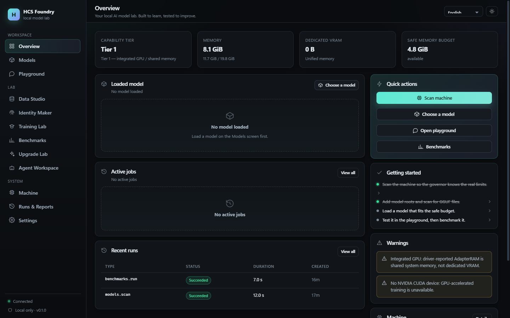
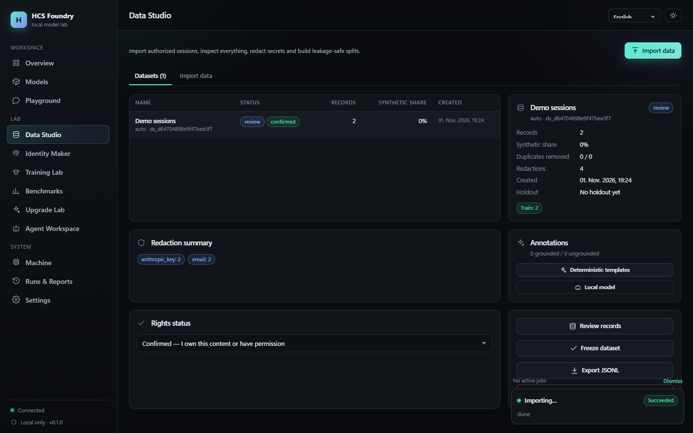
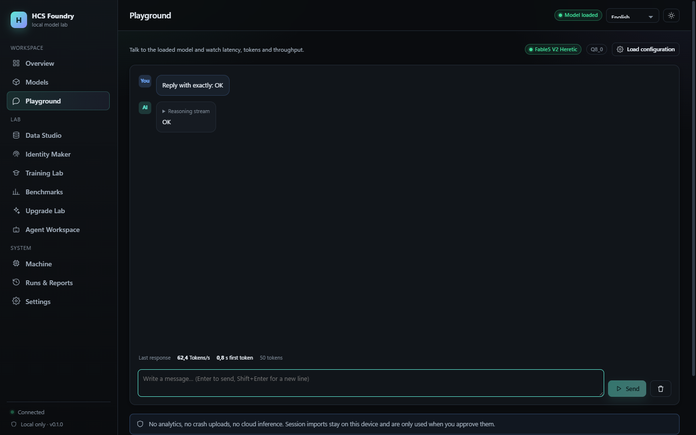

# HCS Foundry

**Your local AI model lab. Built to learn, tested to improve.**

HCS Foundry is a local-first workbench for running, evaluating and improving GGUF language models on your own hardware. It discovers what your machine can actually do, loads a model that fits, lets you talk to it, imports your own agent sessions into a reviewed dataset, benchmarks the result, and proposes upgrades that must pass deterministic gates before they are promoted.

Nothing leaves the machine. There is no telemetry, no cloud fallback, and no automatic download.

<p align="center">
  
</p>

## What works (and what does not)

| Area | Status |
|---|---|
| Machine scan (CPU, RAM, GPU, Vulkan/CUDA/ROCm, disks, toolchains, runtimes) | **Working**, measured on Windows 11 |
| GGUF library with real header metadata and fit estimates | **Working** |
| Local inference through `llama-server` (Vulkan verified) | **Working**, streaming, cancellation, metrics |
| Data Studio: import, redact, dedupe, split, freeze, export | **Working** |
| Identity Maker: one prompt → card → synthetic dataset | **Working** |
| Training Lab | **CPU smoke optimisation verified**; real fine-tuning requires the transformers/peft stack, which is not installed here |
| Benchmarks: instruction adherence, executed codegen, latency | **Working**; UI regression suite via Playwright |
| Upgrade Lab: failure analysis → candidate → evaluation → gate | **Working**; promotion correctly blocked on regressions |
| Agent workspace: plans, allowlisted tools, approval queue | **Working** |
| German / English / French UI, dark/light theme, responsive, keyboard, reduced motion | **Working** |
| TurboQuant KV-cache compression | **Not available** — no discovered build exposes it; the capability probe says so |
| Official SWE-bench / Terminal-Bench / OSWorld / WebArena runs | **Not bundled** — no assets, isolation or licenses are shipped |

See [docs/architecture/KNOWN_LIMITATIONS.md](docs/architecture/KNOWN_LIMITATIONS.md) for the complete, honest list.

## Screenshots

| Models | Data Studio |
|---|---|
|  |  |

| Playground | Training Lab |
|---|---|
|  |  |

## Architecture

```text
┌──────────────────────────────────────────────────────────┐
│ Browser SPA — React 18 + TypeScript + Vite               │
│ de/en/fr · dark/light · charts · SSE job tray            │
└───────────────────────────┬──────────────────────────────┘
                            │ loopback HTTP + SSE, paired token
┌───────────────────────────▼──────────────────────────────┐
│ Foundry service — FastAPI + Pydantic + SQLite (WAL)      │
│ security · jobs · governor · library · datasets · lab    │
└──────┬──────────────────┬──────────────────┬─────────────┘
       │                  │                  │
┌──────▼──────┐   ┌───────▼────────┐  ┌──────▼────────────┐
│ llama-server│   │ torch smoke /  │  │ import pipeline   │
│ subprocess  │   │ preflight      │  │ + benchmarks      │
└──────┬──────┘   └───────┬────────┘  └──────┬────────────┘
       │                  │                  │
┌──────▼──────────────────▼──────────────────▼────────────┐
│ Local storage: SQLite metadata, content-addressed files  │
│ GGUF library · datasets · checkpoints · reports          │
└──────────────────────────────────────────────────────────┘
```

The browser never touches host processes directly. The service binds to `127.0.0.1`, requires a pairing token, and validates `Origin`/`Host` on every request.

## Quick start (Windows)

```powershell
# 1. Backend
cd server
python -m pip install -e .
python -m foundry.cli serve --port 8770

# 2. Frontend (second terminal, for development)
cd web
npm install
npm run dev          # http://127.0.0.1:5173

# or build once and let the service serve it
npm run build        # then open http://127.0.0.1:8770
```

On first start the browser shows a short onboarding: connect to the local service, scan the machine, find models, load one.

Detailed guides: [Windows](docs/INSTALL_WINDOWS.md) · [Linux](docs/INSTALL_LINUX.md) · [macOS](docs/INSTALL_MACOS.md).

## Requirements

- Windows 10/11, Linux or macOS, 64-bit.
- Python 3.11+ (tested on 3.14.6).
- Node.js 20+ (tested on 22.23.1).
- A `llama-server` binary for GGUF inference. The app discovers one; it never downloads one silently.
- 8 GiB RAM minimum, 16 GiB recommended. Integrated GPUs work through Vulkan.

Tested configuration (see [capability matrix](docs/audit/CAPABILITY_MATRIX.md)): AMD Ryzen 7 7735HS, Radeon 680M (unified memory, **no dedicated VRAM**), 19.8 GiB visible RAM, Vulkan, `llama-server` build 11064. Measured: 163 tok/s prompt processing, 46 tok/s generation on a 2B Q4_K_M model.

## Testing

```bash
# backend
cd server && python -m pytest -q          # 98 tests

# frontend unit + translation parity
cd web && npx vitest run                  # 7 tests

# end-to-end (service must be running on :8770)
cd web && npx playwright test             # 6 tests
```

## Privacy

- No analytics, no crash uploads, no remote inference.
- Session imports are read from folders you choose, inside configured roots, and stored locally.
- Secrets and personal identifiers are redacted before records are stored; you review before training.
- The app never reconstructs hidden chain-of-thought. Teaching annotations are evidence-grounded summaries and are labelled synthetic.

Read [docs/DATA_AND_PRIVACY.md](docs/DATA_AND_PRIVACY.md).

## Documentation

- [Repository audit](docs/audit/REPOSITORY_AUDIT.md) · [Capability matrix](docs/audit/CAPABILITY_MATRIX.md)
- [Architecture decisions](docs/architecture/DECISIONS.md) · [Implementation plan](docs/architecture/IMPLEMENTATION_PLAN.md) · [Known limitations](docs/architecture/KNOWN_LIMITATIONS.md)
- [Architecture](docs/ARCHITECTURE.md) · [Security](docs/SECURITY.md)
- [Models & runtimes](docs/MODELS_AND_RUNTIMES.md) · [Data & privacy](docs/DATA_AND_PRIVACY.md)
- [Training](docs/TRAINING.md) · [Benchmarks](docs/BENCHMARKS.md)
- [Changelog](CHANGELOG.md)

## License

MIT — see [LICENSE](LICENSE).

HCS Foundry bundles no model weights, datasets or benchmark assets. Models and datasets you use remain subject to their own licenses and provider terms.

---

Made with ❤️ by **timfromhcs** and **hcsmedia**.
