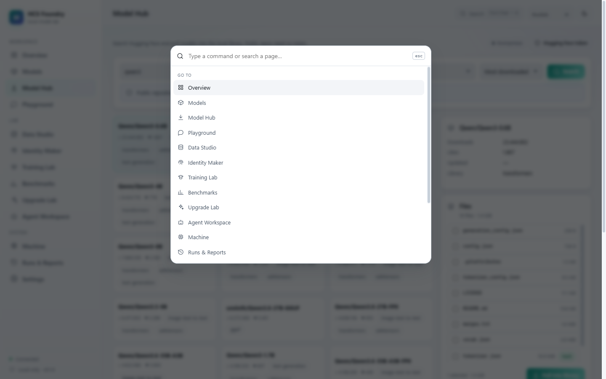

<div align="center">


# HCS Foundry

**Your local AI model lab. Built to learn, tested to improve.**

Pull GGUF models from Hugging Face · run them on Vulkan · clean your own agent logs ·
fine-tune LoRA / INT4 · export and quantize GGUF · MoEfy dense models · benchmark coding
and agentic tasks — all on one machine, with no telemetry and no cloud fallback.

[](https://github.com/timfromhcs/hcs-foundry/actions/workflows/ci.yml)
[](LICENSE)
[](https://github.com/timfromhcs/hcs-foundry/releases)
[](https://www.python.org)
[](https://nodejs.org)
[](#requirements)

[**Download the .exe**](https://github.com/timfromhcs/hcs-foundry/releases/latest/download/HCSFoundry.exe) ·
[Website](https://hcs-foundry-site.vercel.app) ·
[Documentation](docs) ·
[Benchmarks](#benchmarks) ·
[Roadmap](#roadmap)

</div>

---

## Table of contents

- [Why this exists](#why-this-exists)
- [What it does](#what-it-does)
- [Screenshots](#screenshots)
- [Install](#install)
- [Quick start](#quick-start)
- [CLI](#cli)
- [Training](#training)
- [Benchmarks](#benchmarks)
- [Architecture](#architecture)
- [Privacy and security](#privacy-and-security)
- [Honest limitations](#honest-limitations)
- [Roadmap](#roadmap)
- [Development](#development)
- [License](#license)

---

## Why this exists

Local AI tooling is fragmented: one app downloads models, another runs them, a third
trains, a fourth benchmarks, and none of them agree on what the machine can actually do.
HCS Foundry is one local-first workbench that measures the host, refuses what does not
fit, and records evidence for every claim.

Three rules drive the code:

1. **Local by default.** The service binds to `127.0.0.1`, requires a pairing token and
   never sends telemetry. Cloud is opt-in and limited to a teacher role.
2. **No fake success.** A model is not “loaded” until it answers; a job is not “trained”
   until parameters changed and a checkpoint exists; a benchmark is not “passed” because
   a model said so.
3. **Refuse with numbers.** When a configuration cannot fit, the UI and CLI print the
   estimate and the available memory instead of crashing the desktop.

## What it does

| Area | Capability | Status |
|---|---|---|
| **Hub** | Search Hugging Face, inspect files + LFS hashes, pull with **or without** a token, resume, verify, cancel | ✅ verified |
| **Library** | GGUF header metadata, parameter count, KV bytes/token, fit range against live RAM | ✅ |
| **Inference** | Supervised `llama-server`, Vulkan offload, streaming, cancel, metrics, auto-tuned `ngl` | ✅ 2.1× measured |
| **Data Studio** | 5 session adapters, consent gate, redaction, exact + near dedupe, leakage-safe splits, freeze, export | ✅ |
| **Identity Maker** | One prompt → editable identity card → synthetic dataset → deterministic evaluation | ✅ |
| **Training** | SFT, DPO, distillation, INT4/QLoRA (in-RAM, streaming or disk store); tiered weight cache (opt-in); OpenEval; auto LR/stop; best checkpoint | ✅ 0.6B, 1.7B, 4B |
| **GGUF out** | Merge adapter → convert to GGUF → quantize Q2–Q8 → verify by inference | ✅ 0.6B end-to-end, incl. INT4 adapters |
| **MoEfication** | Dense FFN → N experts + top-k router, forward-checked, memory-guarded | ✅ small scale |
| **Benchmarks** | Instruction, executed codegen, repo-fix, agentic, SWE-bench-format adapter (venv per case) | ✅ |
| **Upgrade Lab** | Failure taxonomy → candidate → re-eval → holdout guard → human gate → rollback | ✅ |
| **Agent** | Visible plans, typed allowlisted tools, approval queue, bounded repair | ✅ |
| **UI** | React 18, dark/light, de/en/fr, command palette, mobile nav, reduced motion | ✅ |

## Screenshots

| Pipeline | Models |
|---|---|
|  |  |

| Data Studio | Training |
|---|---|
|  |  |

| Playground | Command palette |
|---|---|
|  |  |

## Install

### Option A — single executable (Windows, recommended)

Download [`HCSFoundry.exe`](https://github.com/timfromhcs/hcs-foundry/releases/latest/download/HCSFoundry.exe)
from the latest release and run it. One self-contained file: API, SPA and Python runtime. The ML stack is excluded.

```powershell
.\HCSFoundry.exe
```

- Opens the browser at `http://127.0.0.1:8770`.
- Data lives in `%LOCALAPPDATA%\HCS Foundry`; the executable can sit anywhere.
- `--port 8780`, `--no-browser`, `--data-dir D:\foundry-data` are supported.
- Fine-tuning is excluded from the bundle (the ML stack would multiply the size); the
  Training Lab says so instead of failing silently. Use Option B for training.

### Option B — from source (all features)

```bash
git clone https://github.com/timfromhcs/hcs-foundry.git
cd hcs-foundry/server
python -m pip install -e .            # add ".[train]" for fine-tuning
python -m foundry.cli serve --port 8770

# second terminal
cd ../web
npm install
npm run build                          # or: npm run dev
```

Open <http://127.0.0.1:8770>.

## Quick start

```bash
# 1. find a model
foundry hf search "qwen3 0.6b" --limit 5

# 2. pull it anonymously (no token needed for public repos)
foundry hf pull Qwen/Qwen3-0.6B --file model.safetensors --file tokenizer.json

# 3. index and run
foundry models scan --root data/models
foundry models run <model-id> --prompt "Explain KV-cache quantization in two sentences"

# 4. clean your own agent sessions
foundry logs clean --json

# 5. train, export, quantize
foundry train unified --dataset <dataset-id> --model data/models/Qwen/Qwen3-0.6B
foundry gguf quantize data/gguf/model-f16.gguf --method Q4_K_M
```

Gated or private repositories need a token once:

```bash
foundry hf token set --token hf_xxx
```

## CLI

Fourteen command groups, `--json` where it matters, non-zero exit codes.

```text
foundry serve | scan | info | token
foundry hf       search | files | pull | token
foundry models   list | scan | verify | load | unload | run
foundry bench    instruction_adherence | codegen_exec | latency_throughput | repo_fix | agentic
foundry train    smoke | preflight | sft | auto | int4 | dpo | distill | unified
foundry gguf     export | quantize | dequantize | inspect
foundry moe      build
foundry tune     vulkan | apply
foundry logs     scan | import | clean
foundry pipeline run
foundry datasets list
```

See [docs/CLI.md](docs/CLI.md) for every flag.

## Training

| Method | What it does | Verified |
|---|---|---|
| **SFT / LoRA** | transformers + PEFT, architecture-aware targets, checkpoints, resume | loss 6.04 → 5.01 on 0.6B |
| **INT4 / QLoRA** | group-wise 4-bit packing, dequantized per layer, LoRA in fp32, no bitsandbytes | 196 layers, loss 5.72 → 4.89 |
| **INT4 + disk store** | weights memory-mapped from `int4-store/`, dequantize-recompute in backward | 4B, 200 layers, loss 4.45 → 3.55 |
| **INT4 + tiered cache** | opt-in RAM LRU + mmap arena on disk (`--vram-gb`) | measured: slower here, off by default (`docs/evidence/v6_vram.md`) |
| **1.7B end to end** | train → merge → GGUF F16 → Q4_K_M → answer | loss 5.02 → 4.08, 51.4 tok/s (`docs/evidence/v6_2b.md`) |
| **DPO** | synthetic preference pairs, adapter-disabled reference | 2-step smoke |
| **Distillation** | local or gateway teacher writes answers, student SFT | tested |
| **Auto** | OpenEval + LR halving + early stop + best checkpoint + playbook | eval 4.344 → 4.233 |

A 4B/8B *quality* fine-tune is out of reach on this hardware: 8.68 GB of BF16 weights become
18.0 GB in fp32 against ~11 GB available. What is verified is the mechanism — a 4B checkpoint
trained through the disk-backed INT4 store for two steps on CPU, with the loss moving
4.453 → 3.545 and 4.57 GB of weights living in memory-mapped files instead of RAM.
Details: [docs/evidence/v41_int4_4b.md](docs/evidence/v41_int4_4b.md).

## Benchmarks

All scores are **project-specific smoke** results, never leaderboard claims.

| Suite | Oracle | Isolation |
|---|---|---|
| Instruction adherence | deterministic assertions (format, language, secrecy, arithmetic) | in-process |
| Code generation | generated Python executed against unit tests | subprocess + timeout |
| Repo fix | model repairs a file, tests run | **per-case venv** |
| Agentic | JSON file tasks, deterministic checks | temp workspace + venv |
| SWE-bench format | official JSONL, local checkouts | **per-instance venv**, command allowlist |

Measured on the test machine (Ryzen 7 7735HS, Radeon 680M, 19.8 GiB):

| Measurement | Result |
|---|---|
| GGUF export (0.6B → F16) | 1.41 GiB in 209 s |
| Quantize F16 → Q4_K_M | 462 MiB, ratio 0.321, 17 s |
| Inference after export | 113.5 tok/s, TTFT 0.79 s |
| Vulkan sweep | 51.4 → 107.8 tok/s (**2.1×**) |
| Auto SFT (6 steps) | eval 4.344 → 4.233 |
| INT4 SFT | loss 5.72 → 4.89 |
| INT4 SFT, 4B, disk store | 200 layers, loss 4.45 → 3.55 in 51 s, 4.57 GB store, 9.45 GB peak RSS (4.57 GB of it file-backed) |
| INT4 SFT, 1.7B + GGUF | loss 5.02 → 4.08, merge 3.80 GiB, Q4_K_M 1223 MiB, **51.4 tok/s** answer |
| Tiered cache (0.6B, 2 steps) | 20.7 s off · 117.1 s with a 3 GB RAM tier · off by default |
| 4B INT4 adapter → fp16 | 200 layers, 6 shards, 8.70 GiB in 514 s |
| 4B Q4_K_M | loads and answers at ctx 512 |

## Architecture

```text
┌─────────────────────────────────────────────────────────────┐
│ Browser SPA — React 18 + TypeScript + Vite                  │
│ de/en/fr · dark/light · command palette · SSE job tray      │
└────────────────────────────┬────────────────────────────────┘
                             │ loopback HTTP + SSE, pairing token
┌────────────────────────────▼────────────────────────────────┐
│ Foundry service — FastAPI + Pydantic + SQLite (WAL)         │
│ security · jobs · governor · library · datasets · training  │
└──────┬──────────────────┬──────────────────┬────────────────┘
       │                  │                  │
┌──────▼──────┐   ┌───────▼────────┐  ┌──────▼────────────┐
│ llama-server│   │ torch trainer  │  │ data pipeline     │
│ subprocess  │   │ SFT/INT4/DPO   │  │ + benchmarks      │
└──────┬──────┘   └───────┬────────┘  └──────┬────────────┘
       │                  │                  │
┌──────▼──────────────────▼──────────────────▼────────────┐
│ Local storage: SQLite metadata + content-addressed files │
│ GGUF library · datasets · checkpoints · reports          │
└──────────────────────────────────────────────────────────┘
```

The browser never touches host processes. The service validates `Host` (loopback),
`Origin` (allowlist), a bearer token, `X-Foundry-Client` on mutations and a path
allowlist on every filesystem access.

## Privacy and security

- **No telemetry, no crash uploads, no remote inference** by default.
- Session imports read only the paths you select, inside configured roots; originals are
  never modified.
- Secrets, emails, phone numbers, credentials and `vck_`/`hf_`/`ghp_` keys are redacted
  before records are stored; previews are redacted too.
- Hidden chain-of-thought is never reconstructed. Teaching notes quote observable
  evidence and are labelled synthetic.
- The optional Vercel AI Gateway teacher is **off by default**, stores its key locally,
  masks it in the API and is the only cloud path.

Details: [docs/SECURITY.md](docs/SECURITY.md) · [docs/DATA_AND_PRIVACY.md](docs/DATA_AND_PRIVACY.md).

## Honest limitations

- **No 4B/8B *quality* fine-tune on this machine.** The pipeline runs at 4B scale through the
  disk-backed INT4 store (a few steps, measured), but a useful run needs many hours of CPU.
  fp32 loading alone would need ≈ 18 GiB against ~6 GiB available.
- **No Vulkan training** — PyTorch has no Vulkan backend; Vulkan is inference only.
- **No GGUF → HF conversion** — only GGUF→F16 requantization is available.
- **Official SWE-bench assets are not bundled**; the adapter runs local checkouts and
  reports `not_run` otherwise.
- **Disk offload costs throughput** — the first pass reads weights from disk; the OS page
  cache is the RAM buffer, not a residency guarantee.

The full list is in [docs/architecture/KNOWN_LIMITATIONS.md](docs/architecture/KNOWN_LIMITATIONS.md).

## Roadmap

- [x] Completed 4B streaming-INT4 training run with measured peak RSS
      ([evidence](docs/evidence/v41_int4_4b.md))
- [x] Permanent Vercel deployment of the landing site
- [x] Paired web demo: the deployed page drives the local service through the pairing flow
      ([evidence](docs/evidence/v5_loop.md))
- [x] INT4 adapter → merged fp16 → GGUF → quantized → answers
- [ ] GGUF → HF safetensors conversion to continue training from a quantized file
- [ ] Verified Vulkan/ROCm training backend when a framework supports it
- [ ] Official SWE-bench / Terminal-Bench assets with hardened isolation
- [ ] More training recipes with measured projections per hardware class

## Development

```bash
cd server && python -m pytest -q      # 204 tests
cd web && npx vitest run              # 7 tests (incl. i18n parity)
cd web && npx playwright test         # 7 E2E tests (service must run)
```

Layout:

```text
server/foundry/     FastAPI service, machine probes, runtime, data, training, benchmarks
web/                React SPA (Vite, TypeScript, i18next)
site/               static landing page (Vercel)
docs/               audit, architecture, guides, evidence
scripts/            build_exe.ps1
```

Build the executable:

```powershell
python -m pip install pyinstaller
powershell -ExecutionPolicy Bypass -File scripts/build_exe.ps1
```

## License

MIT — see [LICENSE](LICENSE). No model weights, datasets or benchmark assets are
bundled; models and datasets remain subject to their own licenses and provider terms.

---

<div align="center">

Made with ❤️ by **timfromhcs** and **hcsmedia**

</div>
