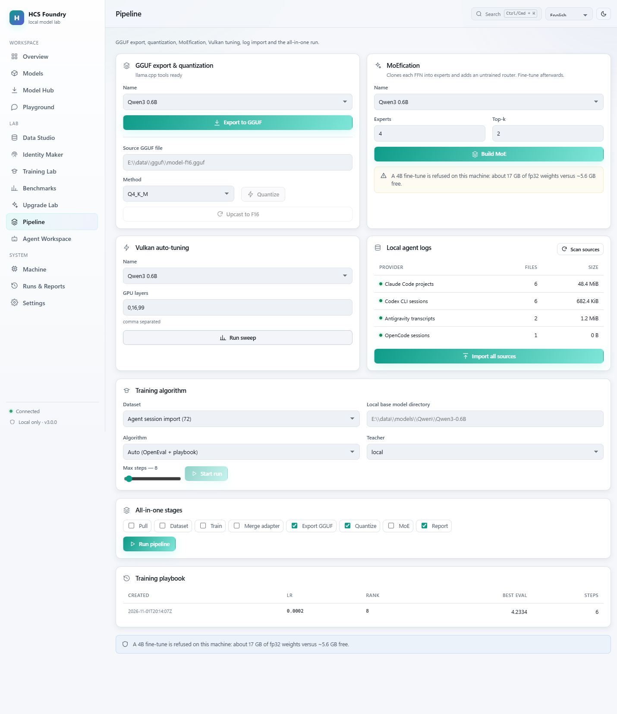
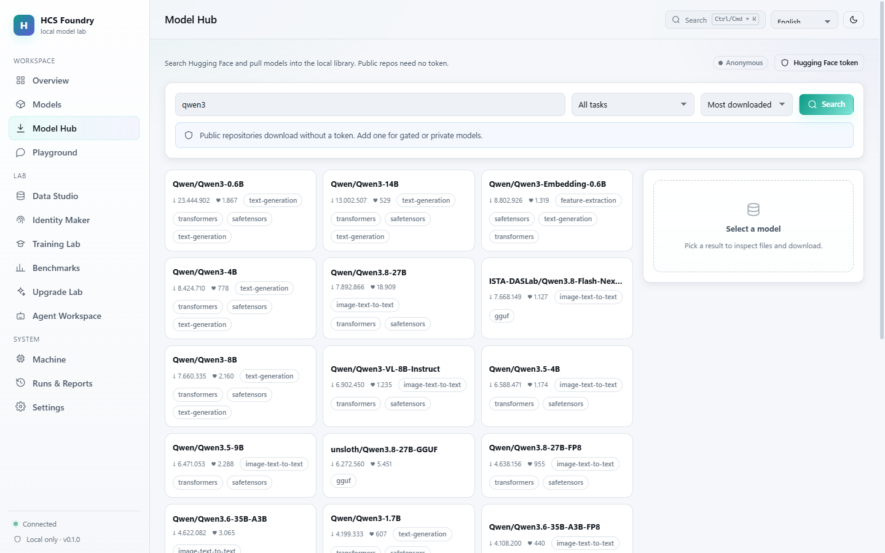
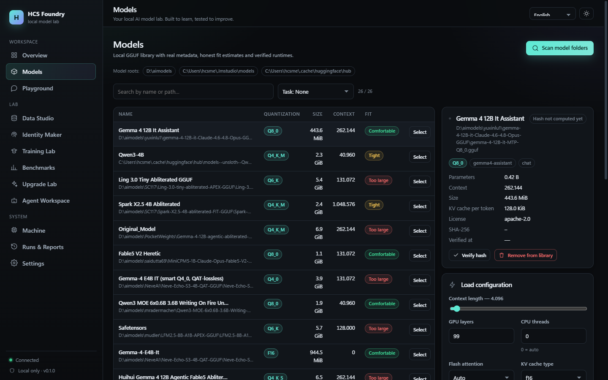
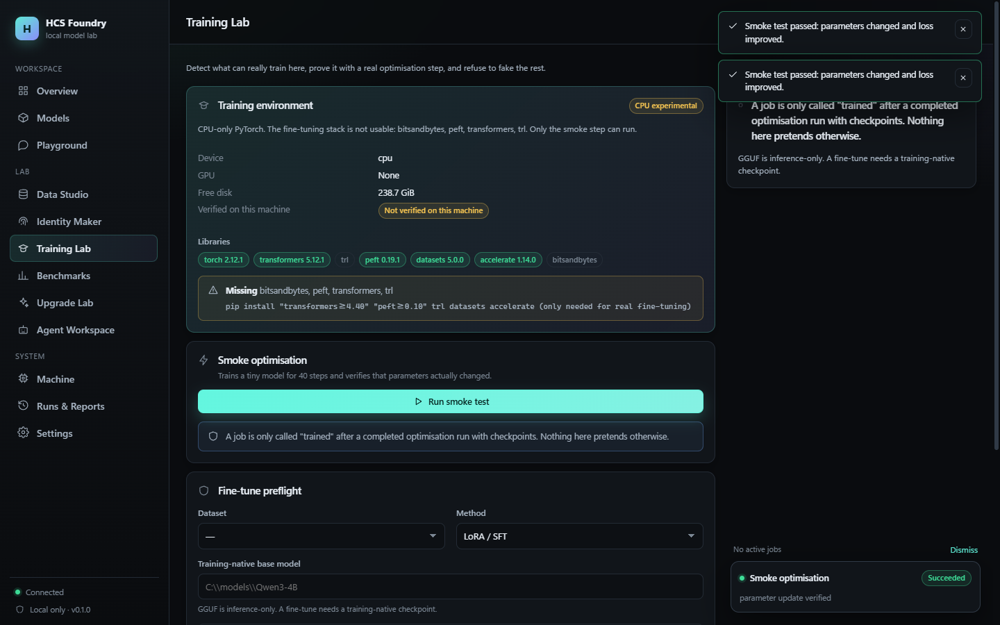

# HCS Foundry v3

**Your local AI model lab. Built to learn, tested to improve.**

HCS Foundry finds and pulls models from Hugging Face, runs GGUF inference on your hardware, imports your own agent sessions into a reviewed dataset, fine-tunes LoRA adapters (fp32, INT4, DPO or distillation), evaluates during training, exports GGUF, quantizes it, converts dense models to MoE, and tunes Vulkan offload — all locally.

No telemetry. No cloud fallback. Nothing leaves the machine unless you explicitly enable it.

<p align="center">
  
</p>

## What is new in v3

| Feature | State | Proof |
|---|---|---|
| **GGUF export** from safetensors | working | Qwen3-0.6B → F16 GGUF, 1.41 GiB in 209 s |
| **Quantization** (Q2_K…Q8_0, F16, BF16) | working | Q4_K_M, 462 MiB, ratio 0.321 |
| **GGUF upcast** to F16/BF16 | working, labelled *upcast* | no GGUF→HF converter exists in the toolchain |
| **MoEfication** (dense FFN → experts + router) | working, untrained router | real conversion with finite forward pass |
| **INT4 / QLoRA training** without bitsandbytes | working | 196 layers, loss 5.72 → 4.86, adapter saved |
| **SFT, DPO, distillation** | working | each tested on tiny models |
| **OpenEval + auto-decision + playbook** | working | eval 4.344 → 4.233, best checkpoint, recipe recorded |
| **Vulkan auto-tuning** | working | ngl=99 → 107.8 tok/s, **2.1× vs CPU** |
| **Real log import** (Claude, Codex, Antigravity, OpenCode) | working | 72 records from this machine, sources untouched |
| **All-in-one pipeline** | working | ordered stages, resumable, JSON + Markdown report |
| **Pipeline UI + 14 CLI command groups** | working | E2E tests green |

## Honest boundaries

- **A complete 4B/8B fine-tune is refused on this machine.** The 4B model ships 8.68 GB of BF16 weights; the trainer loads fp32 (≈17.4 GB) against ~5.6 GB free. The CLI and API refuse with those numbers instead of crashing.
- **Vulkan accelerates inference, not training.** PyTorch has no Vulkan backend here; training is CPU-only and says so.
- **INT4 saves memory during training, not during loading.** The loader still needs the fp32 peak; a streaming loader is the documented next step.
- **GGUF cannot be converted back to HF safetensors** with the discovered tooling. Only GGUF→F16 requantization is offered.

## Screenshots

| Hub | Pipeline |
|---|---|
|  |  |

| Models | Training |
|---|---|
|  |  |

## Quick start

```powershell
# from source
cd server
python -m pip install -e .
python -m foundry.cli serve --port 8770

# or the standalone build
powershell -ExecutionPolicy Bypass -File scripts/build_exe.ps1
.\dist-exe\HCSFoundry.exe
```

### Pull, run, export, quantize

```bash
foundry hf search "qwen3 0.6b" --limit 5
foundry hf pull Qwen/Qwen3-0.6B --file model.safetensors --file tokenizer.json
foundry models scan --root data/models
foundry models run <model-id> --prompt "Say hello"

foundry gguf export <model-id> --dtype f16
foundry gguf quantize data/gguf/model-f16.gguf --method Q4_K_M
foundry tune vulkan <gguf-model-id> --ngl 0,16,99
```

### Train on your own sessions

```bash
foundry logs scan
foundry logs import all --rights confirmed
foundry train auto   --dataset <id> --model data/models/Qwen/Qwen3-0.6B --steps 20
foundry train int4   --dataset <id> --model data/models/Qwen/Qwen3-0.6B --steps 10
foundry train dpo    --dataset <id> --model data/models/Qwen/Qwen3-0.6B --steps 10
foundry train distill --dataset <id> --model data/models/Qwen/Qwen3-0.6B --teacher local
```

### All-in-one

```bash
foundry pipeline run --stages dataset,train,merge,export,quantize,report \
  --sources claude_code,codex,antigravity --dataset <id> --model <path>
```

## Measured on this machine

AMD Ryzen 7 7735HS, Radeon 680M (unified memory, **0 B dedicated VRAM**), 19.8 GiB visible RAM, Vulkan 1.4.357, `llama-server` build 11064.

| Measurement | Value |
|---|---|
| GGUF export (0.6B → F16) | 209 s, 1.41 GiB |
| Quantize F16 → Q4_K_M | 17 s, 462 MiB, ratio 0.321 |
| Inference after export | 113.5 tok/s, TTFT 0.79 s |
| Vulkan sweep | 51.4 tok/s CPU → 107.8 tok/s GPU (2.1×) |
| Auto SFT (0.6B, 6 steps) | eval 4.344 → 4.233 |
| INT4 SFT (0.6B, 2 steps) | loss 5.72 → 4.86, 196 layers quantized |
| 4B Q4_K_M inference | loads and answers on Vulkan at ctx 512 |

## Testing

```bash
cd server && python -m pytest -q      # 149 tests
cd web && npx vitest run              # 7 tests (incl. i18n parity)
cd web && npx playwright test         # 7 E2E tests (service running)
```

GitHub Actions runs all three on a clean Ubuntu checkout.

## Documentation

- [Model Hub](docs/HUB.md) · [CLI](docs/CLI.md) · [Standalone EXE](docs/STANDALONE.md)
- [Training](docs/TRAINING.md) · [Benchmarks](docs/BENCHMARKS.md)
- [Architecture](docs/ARCHITECTURE.md) · [Security](docs/SECURITY.md)
- [Data & privacy](docs/DATA_AND_PRIVACY.md) · [Models & runtimes](docs/MODELS_AND_RUNTIMES.md)
- [v3 plan](docs/plan/V3_PLAN.md) · [Known limitations](docs/architecture/KNOWN_LIMITATIONS.md)
- [Release report v3](docs/evidence/RELEASE_REPORT_V3.md) · [Changelog](CHANGELOG.md)

## Vercel

The static frontend can be deployed; local compute never runs on Vercel. The optional
AI Gateway teacher is opt-in and currently blocked by account billing on this setup.
See [docs/DEPLOY_VERCEL.md](docs/DEPLOY_VERCEL.md) and
[docs/evidence/vercel_setup.md](docs/evidence/vercel_setup.md).

## License

MIT — see [LICENSE](LICENSE). No model weights, datasets or benchmark assets are bundled.

---

Made with ❤️ by **timfromhcs** and **hcsmedia**.
